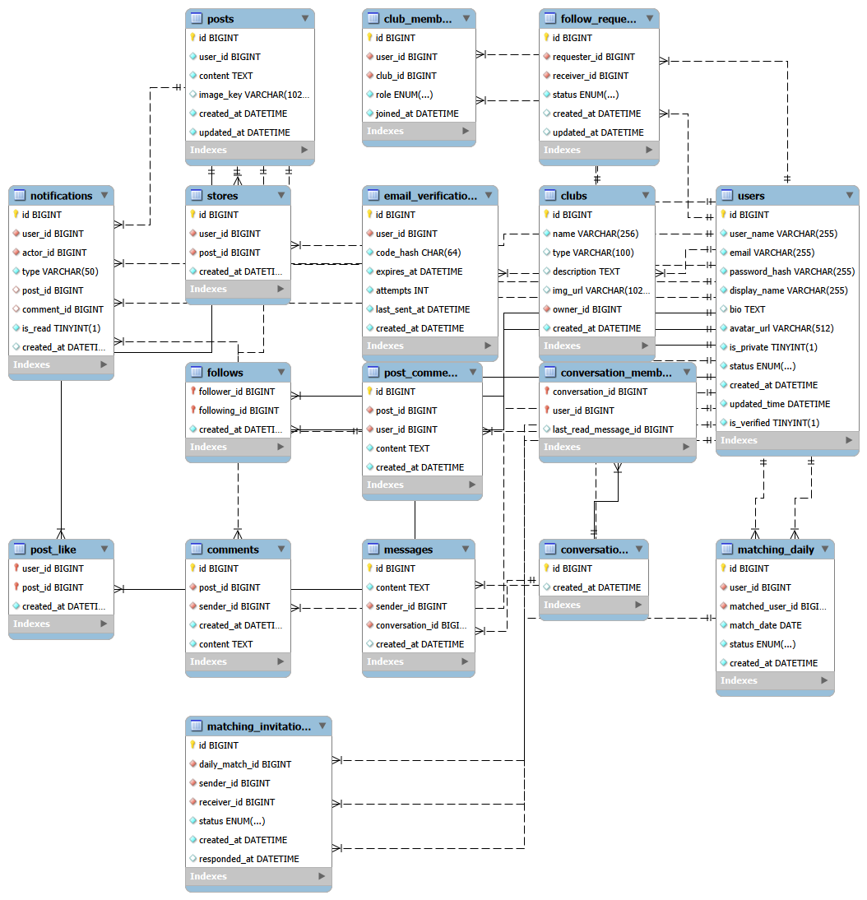
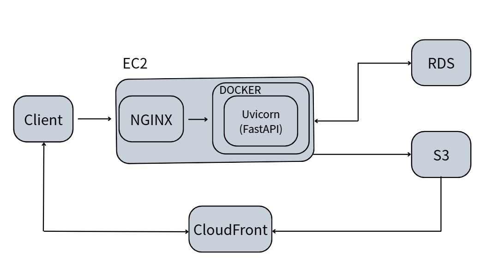

# LinkMe #

本專案以 Instagram 作為參考，並附加配對功能以及簡單的社群功能，
主旨在於讓類似 Instagram 這樣的社群平台能有認識非生活圈的朋友的機會。
主要功能如下:

(1)帳號系統: 個人帳號創建、帳號申請認證(email發送認證碼)、個人資料填寫、個人資料的更改或帳號資訊的更改

(2)權限控管: 對私人帳號、公開帳號、已追蹤帳號、未追蹤帳號、本人帳號作權限控管

(3)即時搜尋: 在搜尋欄中只要打字，若打出的字被包含在某個會員名稱中，便會產生即時搜尋的搜尋清單

(4)無限卷軸貼文顯示與推播: 利用無線卷軸(infinite wrap)的方式顯示貼文

(5)配對功能: 每天有三次配對機會，每到凌晨12:00便會重置機會；已經配對到的目標會顯示在首頁的右側

(6)聊天室功能: 可以與他人進行即時聊天(利用WebSocket協定)

(7)貼文功能: 能夠創建貼文，並能在其他人的貼文按讚和留言

(8)通知功能: 若是被他人追蹤、貼文被他人按讚、貼文被他人留言，便會收到通知 (此部分尚未作 WebSocket 的即時通訊版本)

(9)社群功能: 能創建社群並且加入他人的社群 (目前還沒製作社群頁面)

### 上線網址 ###
https://linkmeabc.vip

# 使用的技術 #
### 前端 ###

(1)HTML

(2)CSS

(3)JavaScript

### 後端 ###

(1)Python(FastAPI)

### 資料庫 ###

(1)本地端使用 MySQL 存取資料

(2)上線端(伺服器端)使用 AWS 的 RDS 保存資料

(3)使用 AWS 的 S3 保存圖片以及部分靜態檔案

### 部署、伺服器以及其他 ###

(1)使用 AWS 的 EC2 作為雲端計算單位，作背景運行

(2)使用 DOCKER 及 DOCKER COMPOSE 作部署

(3)使用 AWS 的 CloudFront 建立多個端點，加快 S3 存取資料的效率

(4)使用 Nginx 作為反向代理

(5)向 Let's Encrypt 申請 SSL 憑證

(6)利用 resend 作電子郵件驗證

# 資料庫架構 #

# 系統架構圖 #

# 核心功能介紹 #

### 登入畫面 ###

